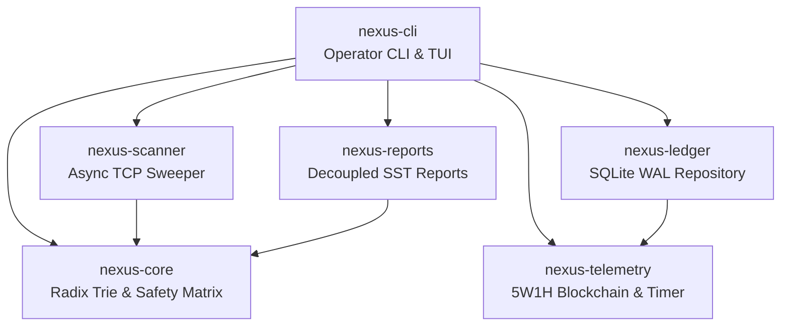

# 🛡️ NexusRecon Architecture & Security Manual (`NEXUS-DOC-ARCH-01`)

> **Air-Gapped Subnet Incident Commander & Network Radar**  
> *Architectural Blueprint, Threat Modeling, Defensive Mitigations, and Cryptographic Non-Repudiation Specifications.*

---

## 📑 Table of Contents
1. [Core Architectural Blueprint (OJP)](#1-core-architectural-blueprint-ojp)
2. [Radix IP Trie Algorithm ($O(k)$ Routing)](#2-radix-ip-trie-algorithm-ok-routing)
3. [Differential Snapshot Engine](#3-differential-snapshot-engine)
4. [Rolling SHA-256 Blockchain Hash-Chain Specification](#4-rolling-sha-256-blockchain-hash-chain-specification)
5. [Strict Zero-Inline HTML & Content Security Policy (CSP)](#5-strict-zero-inline-html--content-security-policy-csp)
6. [CSV Formula Injection Defense (RFC 4180)](#6-csv-formula-injection-defense-rfc-4180)
7. [Threat Model & Attack Vector Resistance](#7-threat-model--attack-vector-resistance)

---

## 1. Core Architectural Blueprint (OJP)

NexusRecon is partitioned into 6 decoupled crates adhering to the **One-Job-Philosophy**:



- **`nexus-core`**: Bitwise Radix IP Trie routing, IEEE MAC OUI lookup, 4-tier safety matrix.
- **`nexus-telemetry`**: Picosecond high-precision timing, 5W1H micro-provenance, SHA-256 blockchain hash-chain.
- **`nexus-scanner`**: Semaphore-bounded async TCP connect scanner and subnet sweeper.
- **`nexus-ledger`**: SQLite WAL persistence with strict parameterized SQL injection defense.
- **`nexus-reports`**: Decoupled Single Source of Truth 6-format report engine.
- **`nexus-cli`**: Command-line interface with colorized ANSI output and monitoring HUD.

---

## 2. Radix IP Trie Algorithm ($O(k)$ Routing)

The `RadixIpTrie<T>` provides $O(k)$ longest-prefix matching for IPv4 subnets, where $k \le 32$:

```text
               Root
              /    \
            0/      \1
            /        \
         Node        Node (128.0.0.0/1)
        /    \
      0/      \1
      /        \
  ...          Node (192.168.0.0/16)
                 \
                  \1
                   Node (192.168.1.0/24) -> [Gateway, Workstations, Implants]
```

### Performance Characteristics
- **Lookup Complexity**: Exactly $k$ bitwise checks (worst case 32 iterations for IPv4).
- **Memory Footprint**: Sparse branch allocation, zero wasted pointer tables.

---

## 3. Differential Snapshot Engine

The `SnapshotDiffEngine` analyzes consecutive `SubnetAuditSnapshot` instances to detect network perimeter mutations:

$$\Delta = \text{Snapshot}_{t_1} - \text{Snapshot}_{t_0}$$

### Detection Capabilities
1. **Rogue Assets**: Newly observed IP or MAC addresses not present in the baseline.
2. **Missing Assets**: Known hosts that failed to respond during the sweep.
3. **Port Surface Drift**: Specific TCP ports newly opened or closed on existing hosts.
4. **Latency Anomalies**: Significant latency spikes indicating routing changes or MITM interception.

---

## 4. Rolling SHA-256 Blockchain Hash-Chain Specification

To guarantee non-repudiation and prevent audit log tampering in contested air-gapped environments, NexusRecon implements a continuous cryptographic hash-chain:

### Genesis Block Computation
$$\text{GenesisHash} = \text{SHA256}(\text{"NEXUS\_RECON\_GENESIS\_V1:"} \parallel \text{SecretKey})$$

### Block Hash Linking Formula
For block $i$:
$$\text{PayloadDigest}_i = \text{SHA256}(\text{JSON}(\text{ProvenanceEntry}_i))$$
$$\text{BlockHash}_i = \text{SHA256}(\text{BE64}(i) \parallel \text{TimestampUTC}_i \parallel \text{PrevHash}_i \parallel \text{PayloadDigest}_i)$$

Where:
- $\text{BE64}(i)$ is the 8-byte big-endian binary representation of block index $i$.
- $\text{PrevHash}_0 = \text{GenesisHash}$.
- $\text{PrevHash}_i = \text{BlockHash}_{i-1}$ for $i > 0$.

If an attacker modifies any record or block in the SQLite ledger, `nexus-recon audit` immediately detects the mismatch and halts with the exact block index of the anomaly.

---

## 5. Strict Zero-Inline HTML & Content Security Policy (CSP)

The HTML5 Dossier (`nexus-reports`) enforces stringent security controls:

### Zero-Inline Rule
- **No Inline Styles**: Zero `style="..."` attributes. All styles reside inside an isolated `<style>` element using CSS variables.
- **No Inline Event Handlers**: Zero `onclick="..."`, `onload="..."`, `onerror="..."` attributes. All DOM interactions and filter event listeners are bound programmatically in `<script>` on `DOMContentLoaded`.

### Content Security Policy
```http
Content-Security-Policy: default-src 'none'; style-src 'unsafe-inline'; script-src 'unsafe-inline'; img-src data:; font-src data:;
```
This guarantees that the rendered report cannot make outbound network requests, execute external scripts, or load CDN resources.

---

## 6. CSV Formula Injection Defense (RFC 4180)

When exporting to CSV, malicious hostnames or banners starting with spreadsheet formula triggers (`=`, `+`, `-`, `@`, `\t`, `\r`) are sanitized:

```rust
pub fn sanitize_csv_field(input: &str) -> String {
    let trimmed = input.trim_start();
    if trimmed.starts_with('=')
        || trimmed.starts_with('+')
        || trimmed.starts_with('-')
        || trimmed.starts_with('@')
        || trimmed.starts_with('\t')
        || trimmed.starts_with('\r')
    {
        format!("'{}", input)
    } else {
        input.to_string()
    }
}
```
This neutralizes Dynamic Data Exchange (DDE) and formula injection attacks when forensic reports are opened in Microsoft Excel, LibreOffice Calc, or Google Sheets.

---

## 7. Threat Model & Attack Vector Resistance

| Threat | Attack Vector | NexusRecon Defense Mechanism |
| :--- | :--- | :--- |
| **Log Tampering** | Attacker deletes or alters scan history in SQLite | SHA-256 rolling blockchain audit detects cryptographic hash break |
| **SQL Injection** | Malicious hostname payload in banner grab | Strict parameterized SQL queries (`rusqlite` prepared statements) |
| **XSS / HTML Injection** | Malicious banner payload injected into HTML report | Strict HTML entity escaping + Zero-CDN strict Content Security Policy |
| **CSV DDE Injection** | Hostname crafted as `=cmd|'/c calc'!A1` | Prefix sanitization prepends single quote `'` to formula triggers |
| **Network DoS** | Excessive concurrent scanning flooding network | Semaphore concurrency limiter (`Arc<Semaphore>`) and configurable worker pools |
